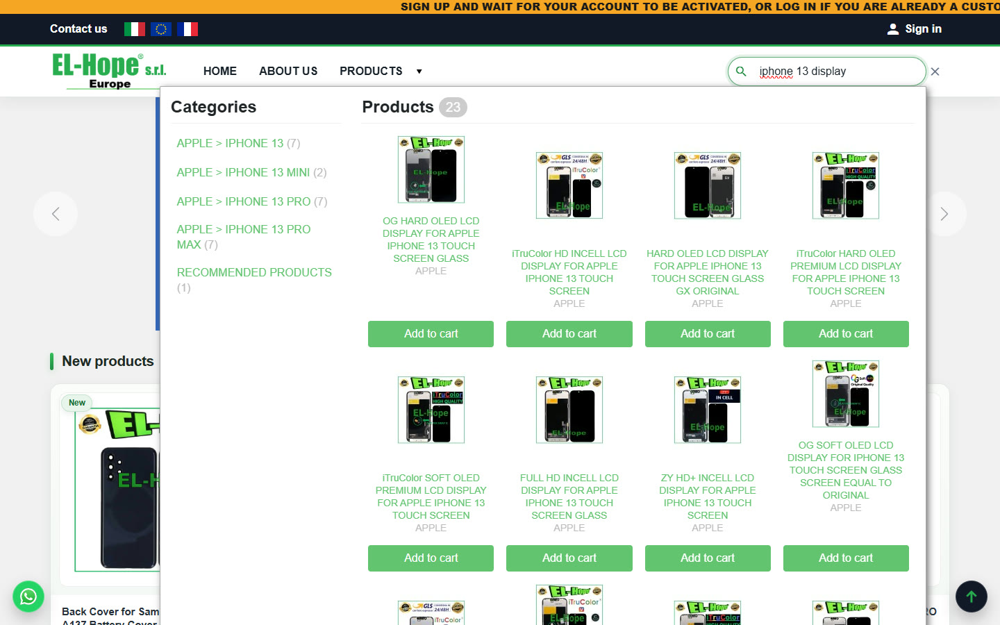
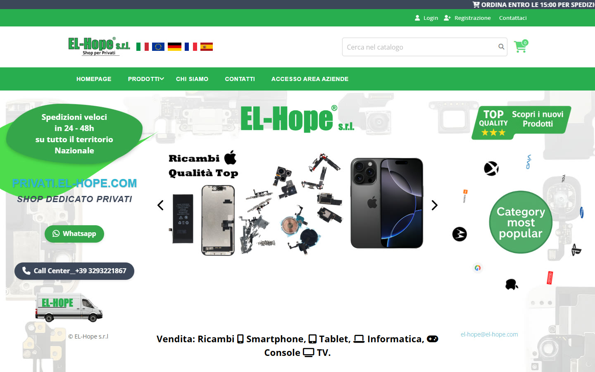
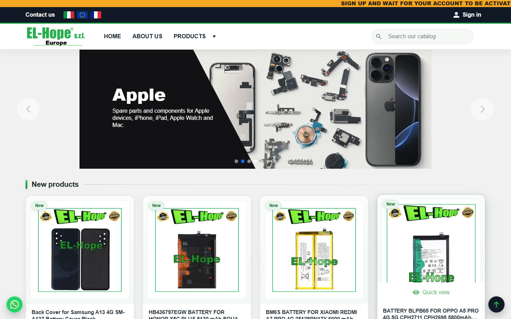
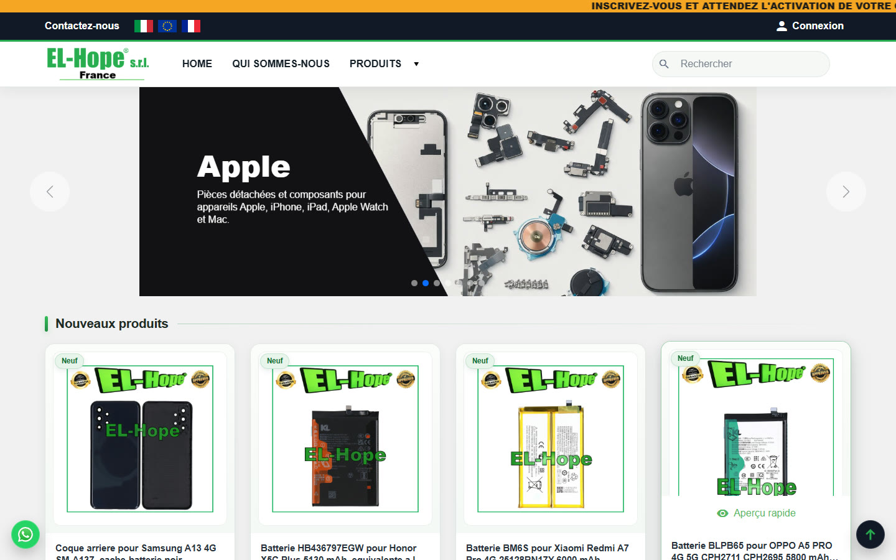

# EL-Hope · e-commerce di ricambi su 4 negozi PrestaShop

Negozi online di [EL-Hope s.r.l.](https://www.el-hope.com), ingrosso e vendita di ricambi per smartphone, tablet, informatica e console: quattro negozi PrestaShop per mercati diversi, sincronizzati con il gestionale aziendale per ordini, magazzino e spedizioni.

| Negozio | Pubblico |
|---|---|
| [el-hope.com](https://www.el-hope.com) | B2B Italia |
| [privati.el-hope.com](https://privati.el-hope.com) | B2C Italia |
| [el-hope.eu](https://www.el-hope.eu) | B2B Europa |
| [el-hope-france.com](https://www.el-hope-france.com) | B2B Francia |

> Codice e configurazioni appartengono al cliente: qui descrivo il tipo di lavoro, i dettagli tecnici li racconto volentieri durante un colloquio.

## Cosa ho fatto
**Aggiornamenti di piattaforma.** Migrazione dei negozi europei all'ultima versione di PrestaShop, con circa 16.800 prodotti per negozio e senza fermare le vendite: procedura provata prima su una copia, problemi della migrazione standard individuati e corretti, tutto documentato in una procedura riusabile per i negozi successivi.

**Ricerca istantanea su misura.** Modulo PrestaShop scritto da me: risultati mentre si scrive, divisi per categorie e prodotti, aggiunta al carrello direttamente dai risultati, indice aggiornato in automatico quando cambia il catalogo.

**Sicurezza e prestazioni.** Analisi del traffico anomalo e protezioni a livello di server che hanno riportato il carico alla normalità, con possibilità di rollback immediato; monitoraggio e manutenzione continua dei server.

## Negozi
| el-hope.com | privati.el-hope.com |
|---|---|
|  |  |
| **el-hope.eu** | **el-hope-france.com** |
|  |  |

**Competenze:** PrestaShop · PHP · MySQL · Smarty · amministrazione di server Linux

---
**Filippo Bonanno** · sviluppatore web · [altri progetti](https://github.com/FilippoBonanno)
